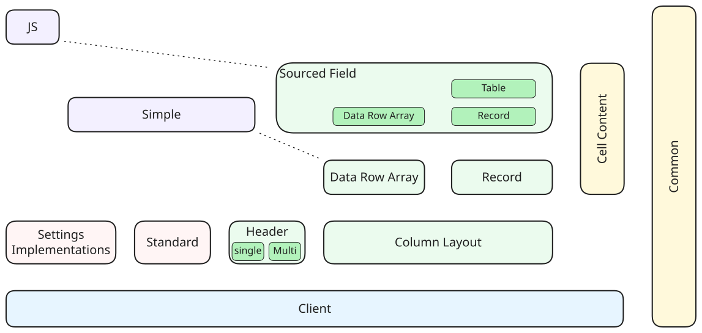

# Modules

The diagram below shows the top level modules within Revgrid:

The colors indicate the type of module:
* **blue**: Client
* **green**: Servers
* **pink**: Libraries that assist with server development
* **purple**: Example grids that combine client and server
* **yellow**: Code common to other modules

The arrangment of modules gives an indication of dependency.  Modules are dependent on those below and the vertical ones on their right.  Dotted lines also show dependencies.

## Brief description

* **[Client](../../client/index.md)**\
Draws the grid on the canvas using data supplied from server and handles UI.
* **[Column Layout](../../servers/column-layout/index.md)**\
Server that enables a column layout to be managed and serialised.  Determines which [fields](../../common/server-interfaces/schema/index.md) '[active columns](../../client/components/columns-manager/index.md)' are linked to, and controls their order, visibility and width.
* **[Data Row Array](../../servers/data-row-array/index.md)**\
Server that provides rows of data from a an array of JSON objects. Each object contains the data for one row and all objects need to have the same keys/properties.  Only supports full grid data updates.
* **[Record](../../servers/record/index.md)**\
Server that maps records to rows allowing data to ignore sorting and filtering of rows.  Also supports highlighting recently changes cells and rows.
* **[Sourced Field](../../servers/sourced-field/index.md)**\
Server supports joining fields from multiple sources into records/rows. It also contains a `Table` server which provides infrastructure for generating tables of realtime data for the client based on table definitions.
* **[Header](../../servers/headings/index.md)**\
Server that provides headings to a grid's header [subgrid](../../client/components/subgrids-manager/index.md). Includes 2 servers: one for single row header and the other for multi row header.
* **[Settings Implementation](../../settings/index.md)**\
Provides several implementations for [settings](../../settings/index.md) used in client.  Includes: default, in-memory and readonly implementations.
* **[Standard](../../libraries/standard/index.md)**\
Provides some standard libraries for: painters, [cell painters](../../cell-painter/index.md) and [cell editors](../../cell-editor/index.md) which can be used in servers.  Also includes some specialised classes for managing custom headings and caching table field source definitions.
* **[Simple](../../libraries/simple/index.md)**\
Demonstrates how to create a simple grid which [extends the client settings](../../settings/simple/index.md) that are then used in a custom [cell painter](../../cell-painter/index.md). Includes one grid which just extends the [client grid](../../client/grid/index.md) and another which extends the [Data Row Array](../../servers/data-row-array/index.md) grid.
* **[JS](../../libraries/javascript/index.md)**\
Provides a client grid and a table grid without any generic parameters.  These can be used in JavaScript applications.
* **[Common](../../common/index.md)**\
Declares server interfaces used by client to access servers and provides types and utilities used by both server and client.
* **Cell Content**\
Utility classes and enumerations that assist with generating cell content.

## API

The sidebar on the left shows the API for each of these modules.

## Public API Surface Inventory

Revgrid publishes public symbols from the root entry module (`index`) and the submodules listed below. For each module, generated API Reference pages include classes, interfaces, type aliases, enums, namespaces, constants, and member signatures.

1. Client (`client`)
Includes grid classes, behavior classes, components, interfaces, settings contracts, and UI controller types.
1. Common (`common`)
Includes server interface contracts and shared utility types/enums/constants.
1. Data Row Array (`data-row-array`)
Includes array-backed server classes and grid wrappers.
1. Record (`record`)
Includes record model classes, definitions, schema/data servers, and helpers.
1. Column Layout (`column-layout`)
Includes layout/reference definitions and supporting server/grid abstractions.
1. Header (`header`)
Includes single-heading and multi-heading server implementations.
1. Sourced Field (`sourced-field`)
Includes sourced-field definitions, record/table/data-row-array variants, and related servers.
1. Standard (`standard`)
Includes standard painters, editors, and server-side helper services.
1. Simple (`simple`)
Includes simple grid wrappers, settings, and simple painter utilities.
1. JS (`js`)
Includes JavaScript-first wrappers that reduce generic complexity.
1. Settings Implementations (`settings-implementations`)
Includes default, in-memory, and readonly settings classes.
1. Cell Content (`cell-content`)
Includes text/formatting enums and helpers for value presentation.

### How To Navigate Comprehensive Member Docs

1. Open the module in API Reference.
1. Open a class/interface/enum/namespace page.
1. Use the Members section to see all properties, methods, call signatures, and inherited members.
1. Use source module navigation to inspect sibling symbol families.

